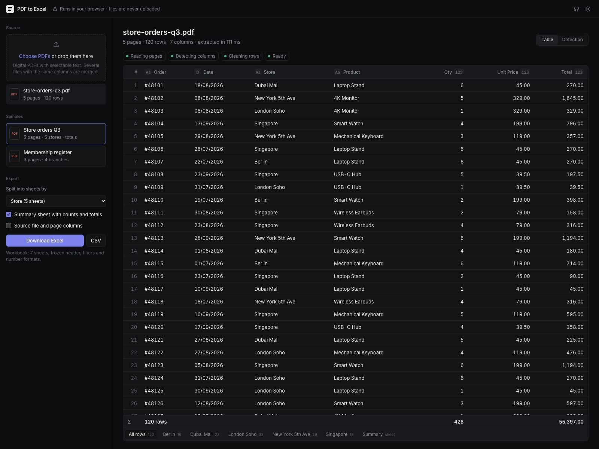
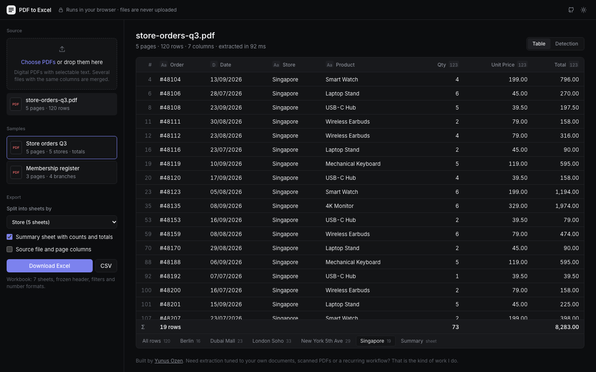
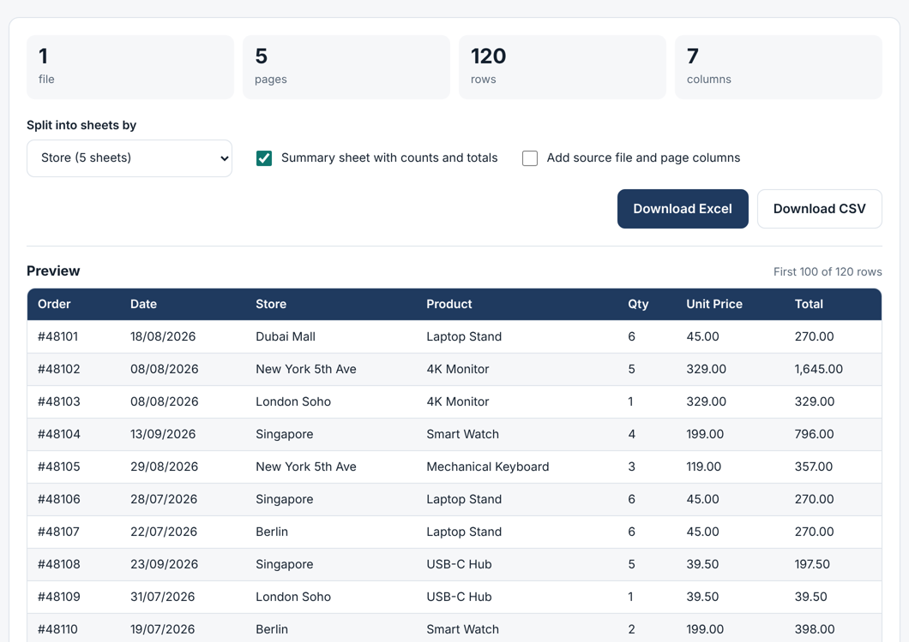

# PDF to Excel Extractor

Turn tables in PDF reports into clean, formatted Excel workbooks, right in the browser.

**Live demo:** https://ozenyunus35.github.io/pdf-data-extractor/



## What it does

- Finds the table on every page of one or more PDFs and rebuilds rows and columns from the layout.
- Drops what is not data: titles, notes, page numbers, and the header repeated on each page.
- Splits the records into **one sheet per group** (for example per branch, store or region).
- Adds a **summary sheet** with record counts and totals per group.
- Exports a styled `.xlsx` (frozen header, filters, number formats, sized columns) or a UTF-8 `.csv`.
- Merges several PDFs with the same columns into one workbook, with optional source file and page columns.
- **Detection view**: the PDF page with what was found drawn on top (header, data rows, skipped titles and
  footers, column bounds). Click a row on the page to jump to it in the table.
- Table preview with column types, totals and Excel-style sheet tabs that match the export.
- **Numbers in any notation**: `1,234.50`, `1.234,50`, `1 234,50`, `6.497,76 €`, `(45.00)`, `45.00-`, `120.00 DR`,
  `12.5%`. Amounts are stored as numbers, percentages as percentages and dates (`14.03.2026`, `03/14/2026`,
  `14 Mar 2026`, `March 14, 2026`) as real Excel dates.
- **Identifiers stay text**: account numbers with leading zeros, ZIP codes and 16-digit card numbers keep every digit.
- **Totals inside the table** (subtotals, grand total) are set aside so nothing is counted twice, and the rows are
  checked against the printed grand total.
- **Several tables in one file**: the largest is shown first, the others can be picked and exported.
- **Password-protected PDFs** ask for the password; turned pages (`/Rotate` or landscape tables printed sideways)
  are read upright and drawn in the right place in the detection view.
- CSV that is safe to open: text starting with `=`, `+`, `-` or `@` cannot run as a formula, and on a
  decimal-comma locale (Turkish, German, French) fields are split by `;` so Excel opens them in columns.

Files are processed locally with PDF.js. Nothing is uploaded to a server.

| Table and sheet tabs | Detection view |
| --- | --- |
|  |  |

## How the table detection works

PDFs do not store tables, only positioned text. The extractor:

1. Reads every text run and its position, and splits runs into words, because PDF.js often merges
   neighbouring cells into a single run (`"6,568.83 Paid"`).
2. Finds columns from **gutters**: vertical strips that no table row puts text into. Gaps between words
   inside a cell move from row to row, real column gaps do not.
3. Sets aside lines that run across the gutters (titles, notes, footers) and recomputes the gutters
   strictly from the remaining rows.
4. Folds back "columns" that are really the tail of one long value (`New York 5th Ave`).
5. Takes the header from the first non-numeric grid line (year columns such as `2026 | 2025` count as labels),
   folds header labels wrapped over several lines, or uses the line just above the first row when the header
   labels are wider than the data.
6. Removes page furniture first (`Page 3 of 12`, running headers), joins letters drawn edge to edge
   (ligatures, CJK text) and keeps a number together with its unit and its space-grouped thousands.

The logic lives in [`src/table.ts`](src/table.ts), with cell values in [`src/values.ts`](src/values.ts) and
page rotation in [`src/frame.ts`](src/frame.ts).

## Tests

`npm test` runs the extractor on PDFs from three generators (ReportLab, Chrome's print-to-PDF and hand-written
PDF), including a stress set made by [`scripts/make_stress.mjs`](scripts/make_stress.mjs): German, Turkish,
French, US and Japanese number formats, a 2,400-row table over 41 pages, subtotals, two tables in one file,
year headers, three-line headers, identifiers, turned pages, and files that are encrypted, empty, truncated or
not PDFs at all. The workbook and CSV are read back and checked cell by cell. `npm run test:e2e` runs the app in
desktop Chrome, Safari, iPhone and Android.

## Run it locally

```bash
npm install
npm run dev      # http://localhost:5173
npm test         # value, extraction, stress and export tests
npm run build    # static site in dist/
npm run test:e2e # Playwright: desktop Chrome, Safari, iPhone and Android
```

The sample PDFs in `public/samples/` contain synthetic data and are generated by
`scripts/make_samples.py`.

## Limits

- Works with digital PDFs whose text can be selected. Scanned PDFs need OCR first.
- Reads each table on its own; nested tables and cells merged across several columns may need tuning.

## Tech

TypeScript, Vite, PDF.js, ExcelJS, Playwright. Tests and deploy to GitHub Pages run in GitHub Actions.

---

Built by [Yunus Ozen](https://ozenyunus35.github.io/yunus-ozen-portfolio/). Need extraction tuned to your own
documents, OCR for scanned files, or a recurring workflow? Get in touch.
