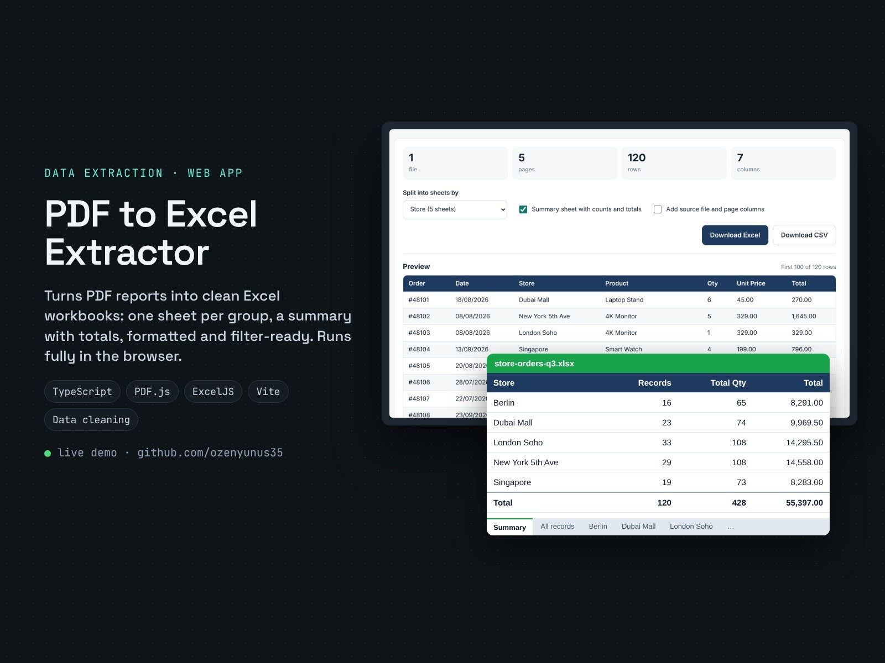
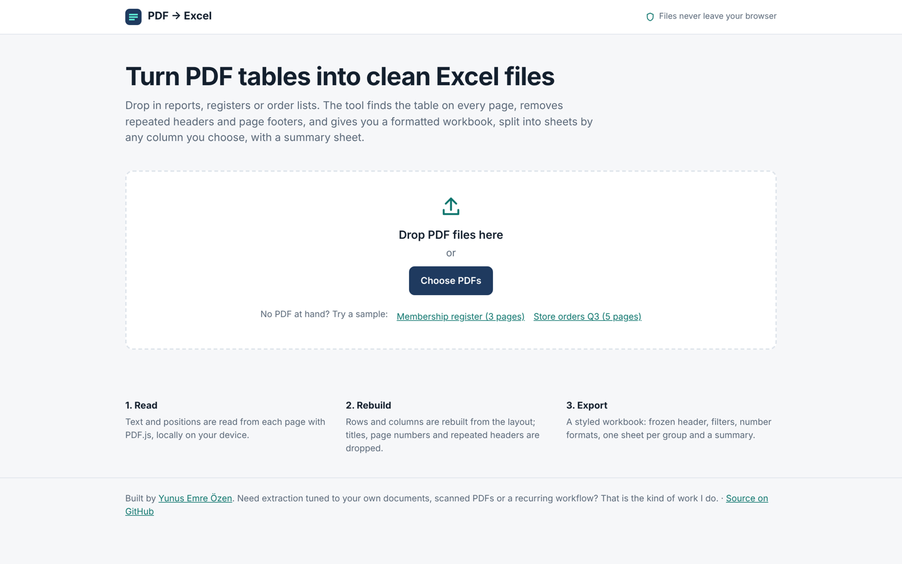
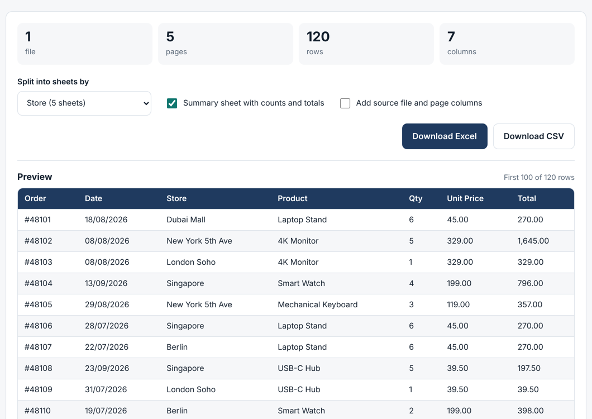

# PDF to Excel Extractor

Turn tables in PDF reports into clean, formatted Excel workbooks, right in the browser.

**Live demo:** https://ozenyunus35.github.io/pdf-data-extractor/



## What it does

- Finds the table on every page of one or more PDFs and rebuilds rows and columns from the layout.
- Drops what is not data: titles, notes, page numbers, and the header repeated on each page.
- Splits the records into **one sheet per group** (for example per branch, store or region).
- Adds a **summary sheet** with record counts and totals per group.
- Exports a styled `.xlsx` (frozen header, filters, number formats, sized columns) or a UTF-8 `.csv`.
- Merges several PDFs with the same columns into one workbook, with optional source file and page columns.

Files are processed locally with PDF.js. Nothing is uploaded to a server.

| Upload | Result |
| --- | --- |
|  |  |

## How the table detection works

PDFs do not store tables, only positioned text. The extractor:

1. Reads every text run and its position, and splits runs into words, because PDF.js often merges
   neighbouring cells into a single run (`"6,568.83 Paid"`).
2. Finds columns from **gutters**: vertical strips that no table row puts text into. Gaps between words
   inside a cell move from row to row, real column gaps do not.
3. Sets aside lines that run across the gutters (titles, notes, footers) and recomputes the gutters
   strictly from the remaining rows.
4. Folds back "columns" that are really the tail of one long value (`New York 5th Ave`).
5. Takes the header from the first non-numeric grid line, or from the line just above the first row
   when the header labels are wider than the data.

The logic lives in [`src/table.ts`](src/table.ts) and is covered by tests against PDFs from two different
generators (ReportLab and Chrome's print-to-PDF).

## Run it locally

```bash
npm install
npm run dev      # http://localhost:5173
npm test         # extraction tests on the sample PDFs
npm run build    # static site in dist/
```

The sample PDFs in `public/samples/` contain synthetic data and are generated by
`scripts/make_samples.py`.

## Limits

- Works with digital PDFs whose text can be selected. Scanned PDFs need OCR first.
- Designed for one main table per document; complex nested or merged-cell layouts may need tuning.

## Tech

TypeScript, Vite, PDF.js, ExcelJS. Deployed to GitHub Pages with GitHub Actions.

---

Built by [Yunus Ozen](https://ozenyunus35.github.io/yunus-ozen-portfolio/). Need extraction tuned to your own
documents, OCR for scanned files, or a recurring workflow? Get in touch.
